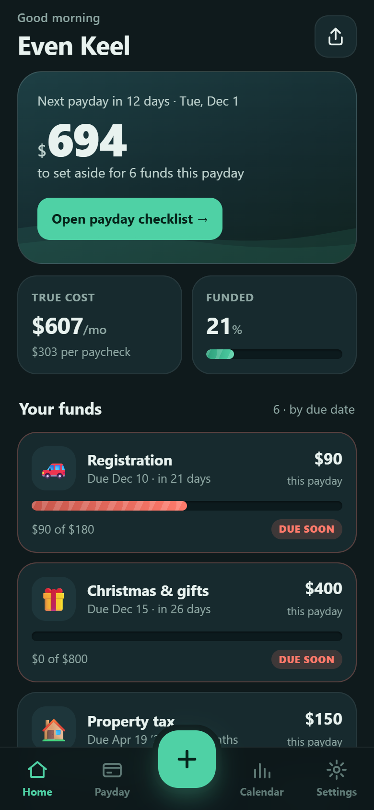
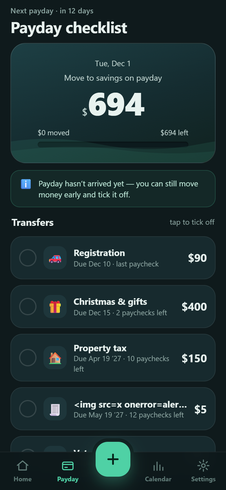
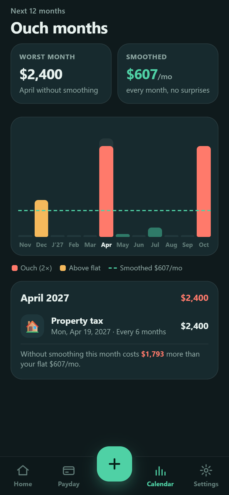
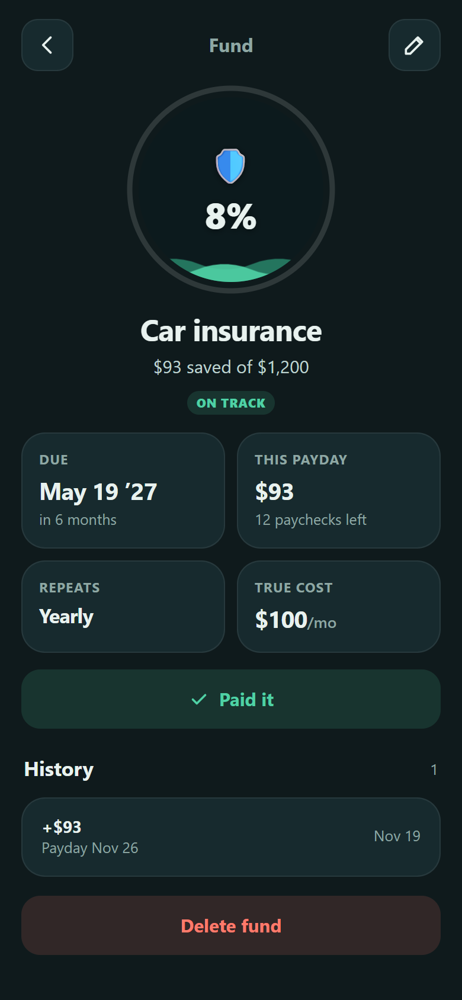
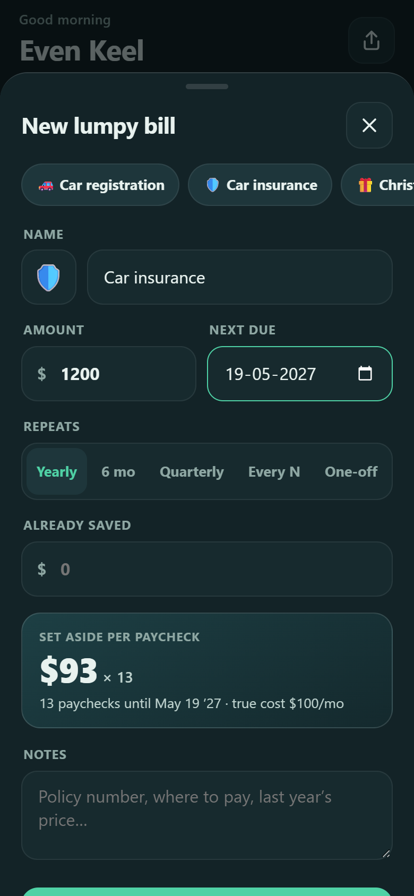
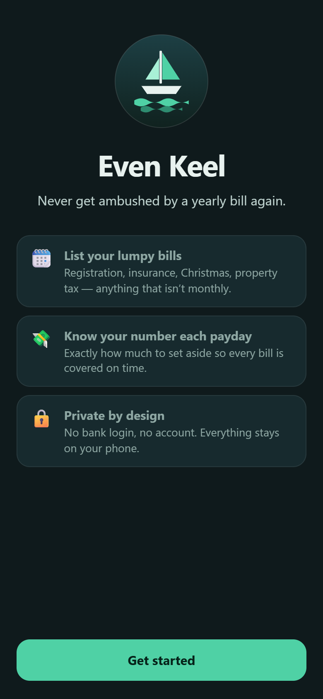

# Even Keel

**Never get ambushed by a yearly bill again: exactly how much to set aside this payday for every lumpy expense.**

## The problem

Monthly bills are easy to budget. Car registration, annual insurance, yearly subscriptions, holidays and semi-annual bills are not. They show up as $300–$5,000 surprises that make a budget feel pointless. The usual fix is **sinking funds**: list each bill and divide what's left by the number of paychecks before it's due. Most people do that math in a spreadsheet or pay for a full budgeting app.

Evidence:

- [The Cool Down write-up of a Reddit thread](https://www.thecooldown.com/?p=793578): the poster's regular budget is predictable, but random $3k–$5k expenses make budgeting "feel pointless".
- [r/ynab feature-request thread](https://reddit.birdcat.cafe/r/ynab/comments/1isgpkh/if_you_were_to_update_ynab_what_feature_you_wanna): YNAB has no good way to save for sinking funds unless you create an account per category.
- [GummySearch: budgeting apps on Reddit](https://gummysearch.com/tools/best-products/budgeting-apps/): Reddit budgeting threads lean toward free homemade spreadsheets with no bank connections.
- [Waypoint Budget](https://waypointbudget.com/blog/common-expenses-canadians-overlook): semi-annual and annual bills are commonly overlooked.
- [Gerald: sinking fund apps](https://joingerald.com/learn/saving--investing/sinking-fund-apps-annual-bills): the recommended per-paycheck method is done by hand. This is a vendor blog, so read it with caution.
- [dev.to: why people quit YNAB](https://dev.to/shahmeer/why-people-are-quietly-quitting-ynab-and-what-they-are-switching-to-1k9g): users leave over cost and complexity and want something lighter.

Even Keel is that lighter tool. It's free, works offline, needs no bank login, and does one job.

## Features

- **Lumpy-bill list.** Add a bill with a name, an icon (picked automatically from the name), the amount, the next due date and how often it repeats: yearly, every 6 months, quarterly, every N months, or one-off. Quick-add presets cover car registration, car insurance, Christmas, annual subscriptions, property tax, vet checkups, back-to-school and holidays.
- **Pay schedule engine.** Supports weekly, biweekly, semi-monthly (any two days, with month-end handled) and monthly pay. For each bill the app counts the paychecks left before the due date and works out `(amount − saved) ÷ paychecks left`, rounded up to the exact cent, the nearest 1 or the nearest 5 (your choice).
- **Payday checklist.** One screen shows every fund with this paycheck's amount and a large total ("Move $689 to savings"). Tap a line, or tap "Mark all moved", to log the transfers. The device vibrates and the checkmarks animate. If you miss a payday, the app moves to the next one and raises the amounts to catch up, with a note explaining why.
- **Fund status and payout.** Each fund shows a water-line progress bar and a status badge: on track, behind, due soon or ready. The detail screen has a water-tank gauge, a due countdown, the contribution history, and a "Paid it" flow where you enter the actual amount. Any surplus or shortfall is recorded, the surplus can carry into the next cycle, and the fund resets for its next due date. One-off funds are archived after payment.
- **Ouch-month calendar.** A 12-month bar chart shows how much each month would cost without smoothing, with a dashed line for the flat smoothed amount. Tap a month to see its bills.
- **True monthly cost.** The home screen shows what your lumpy bills really cost per month and per paycheck.
- **Share and backup.** "Share summary" sends plain text through the Android share sheet. You can export your data as JSON (copy or share) and import it later by pasting it back. There's also a full reset.
- Android back-button support, in-app dialogs (no browser popups), and a calm dark nautical theme.

## Screenshots

| Home | Payday checklist | Ouch months |
|---|---|---|
|  |  |  |

| Fund detail | Add bill | Onboarding |
|---|---|---|
|  |  |  |

## Install

Download `app-release.apk` from this repository's **GitHub Releases** page and open it on your Android phone. You may need to allow installs from unknown sources.

## Tech notes

- Vanilla HTML/CSS/JS in `app/src/main/assets/www/` (`index.html`, `styles.css`, `app.js`), loaded by a thin Android WebView shell (`MainActivity.java`).
- No network access at all: no CDNs, no web fonts, no analytics. Uses the system font stack.
- All data lives in `localStorage` under the key `evenkeel.v1` (settings, funds, contributions, payments, completed and skipped paydays).
- All date math uses local `YYYY-MM-DD` dates. A payday counts toward a bill when it falls on or before the due date.
- Native bridge features are detected before use: `Android.vibrate`, `Android.share`. The back button calls `window.onAndroidBack()`.
- QA: `_qa/scenario.js` runs the IDEA test scenarios in headless Chromium, with assertions on the per-paycheck math, payday completion, skipped-payday catch-up, the "Paid it" surplus carry, the pay-schedule switch, share, and export/reset/import.

Built autonomously by the Auto Builder agent swarm (Claude Code).
